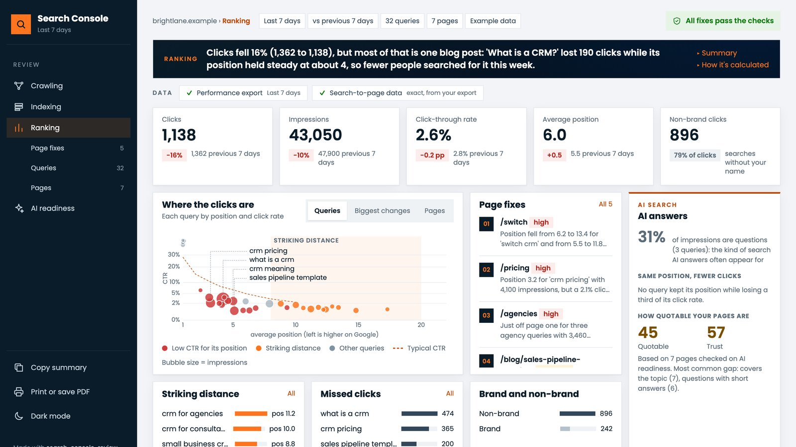
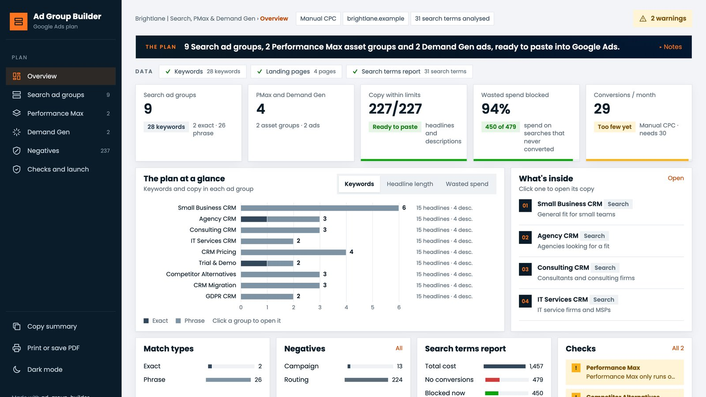
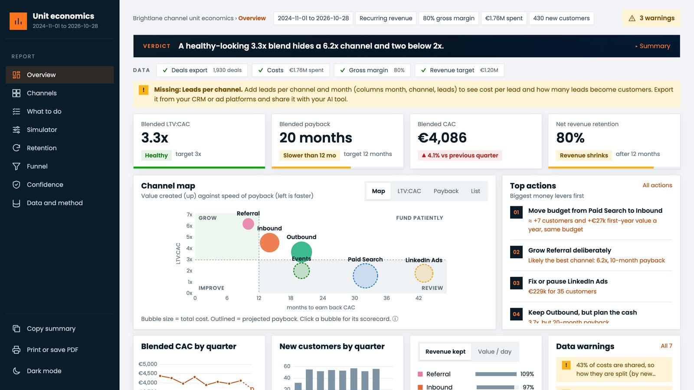

# Eli Nogueira

**Senior Marketing & Analytics Manager** · Munich

I turn marketing spend into measurable pipeline. For 8+ years in B2B tech and higher education I've worked where marketing, sales and data meet: paid search, CRM & automation, and attribution & BI. When the tool I need doesn't exist, I build it.

`TECHNOLOGY × DATA × PROCESS = PERFORMANCE`

---

### 1. What I build

Tools for the weekly marketing ops work that eats hours. Each one reads an export you already have and returns one page with the answer and the next action. No API keys, and no data leaves your computer.

#### 1.1 Search Console Review · *Coming soon*

Traffic dropped, but is it seasonality, rankings or click rate? Finds the cause and writes the page fixes, measured in pixels the way Google truncates.

#### 1.2 Ad Group Builder · *Coming soon*

Low-volume and B2B Google Ads accounts follow big-account advice and overpay. Groups keywords by intent, picks match types and negatives, writes the ads.

#### 1.3 Channel Unit Economics · *Coming soon*

Cost per lead hides which channels lose money. Calculates fully loaded CAC, LTV and payback per channel, in the language finance uses.

All screenshots show demo reports built from fictitious data.

---

### 2. How I work

#### 2.1 Principles

- **Diagnose first.** Find out why the number moved before changing anything.
- **Judge spend on revenue.** Clicks and leads are inputs; deals, enrolments and payback are the result.
- **Say how far to trust it.** Every report I build states its data gaps.
- **Automate the repeat work** so the team spends its time on decisions.

#### 2.2 Stack

- **CRM & automation:** Salesforce · Account Engagement (Pardot) · HubSpot
- **Ads & SEO:** Google Ads · Microsoft Ads · LinkedIn Ads · Search Console · SEMrush · Screaming Frog
- **Tracking & BI:** GA4 · Google Tag Manager · Matomo · Power BI · Looker Studio · VWO
- **Building:** Python · Claude Code · LLM workflows

#### 2.3 Credentials

- M.Sc. Marketing, King's College London (Distinction)
- Salesforce Certified Platform Administrator
- Microsoft Certified Power BI Data Analyst

---

### 3. Currently

- Testing how AI assistants cite brands, and what makes them cite yours (GEO)
- Writing LinkedIn posts that take one real CRM problem and show the fix

  
  

---

### 4. Disclaimer

> [!WARNING]
> **Independent projects.** All repositories on this profile are personal projects, developed in my own time and with my own resources. They are not commissioned by, affiliated with or endorsed by any current or former employer or client, and they do not use any employer's or client's data, systems or confidential information.
>
> **Demonstration data only.** All examples and sample outputs use fictitious datasets. Any resemblance to real organisations, people or results is coincidental.
>
> **Adaptation required.** The tools are provided "as is", without warranty of any kind, under the MIT License. Before using them in a business context, you are responsible for adapting them to your own data, systems and processes, validating the results, and ensuring compliance with applicable law, including data protection rules such as the GDPR.
